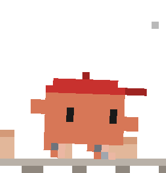
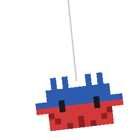
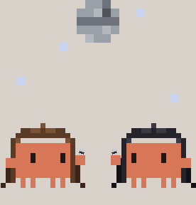
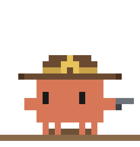
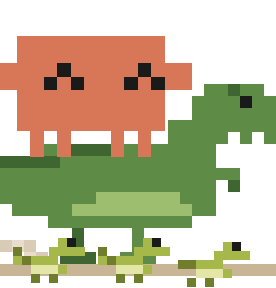
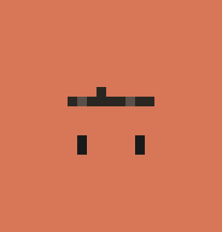
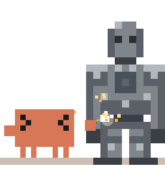
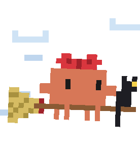

# clawd-moji

Clawd 表情包合集。主角是 Claude Code 的像素小螃蟹 Clawd，一套一个主题，全部用代码生成。

> Clawd 角色属于 Anthropic。本仓库是粉丝创作，非官方、非商用。各套 `src/` 里的代码用 MIT，表情图仅限个人非商用，详见 [LICENSE](LICENSE)。

## 套装

| 编号 | 主题 | 内容 | 状态 |
|---|---|---|---|
| 01 | [movie-night](01-movie-night/) | 影视主题 · 20 个 | 完成 |

### 01 · movie-night

<table>
  <tr>
    <td align="center" width="20%"> 降临克</td>
    <td align="center" width="20%"> 星克穿越</td>
    <td align="center" width="20%"> 肖申克的救赎</td>
    <td align="center" width="20%"> 泰坦尼克号</td>
    <td align="center" width="20%"> 西游克</td>
  </tr>
  <tr>
    <td align="center" width="20%"> 第九克</td>
    <td align="center" width="20%"> 黑克帝国</td>
    <td align="center" width="20%"> 寻克环游记</td>
    <td align="center" width="20%"> 金刚克</td>
    <td align="center" width="20%"> 电锯惊克</td>
  </tr>
  <tr>
    <td align="center" width="20%"> 阿克正传</td>
    <td align="center" width="20%"> 蜘蛛克</td>
    <td align="center" width="20%"> 哈利波克</td>
    <td align="center" width="20%"> 星克大战</td>
    <td align="center" width="20%"> 行克走克</td>
  </tr>
  <tr>
    <td align="center" width="20%"> 克门的世界</td>
    <td align="center" width="20%"> 侏罗克公园</td>
    <td align="center" width="20%"> 痴克</td>
    <td align="center" width="20%"> 钢铁克</td>
    <td align="center" width="20%"> 魔女宅克</td>
  </tr>
</table>

👉 每个的小说明见 <a href="01-movie-night/">01-movie-night</a>

## 结构

每套一个文件夹，各放各的：

- `gif/` —— 成品动图
- `preview.png` —— 这套的总览图
- `src/` —— 这套自己的生成代码
- `README.md` —— 这套的清单和预览
